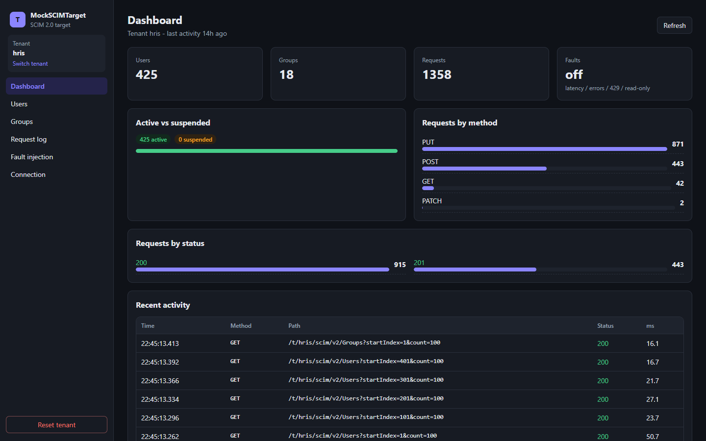
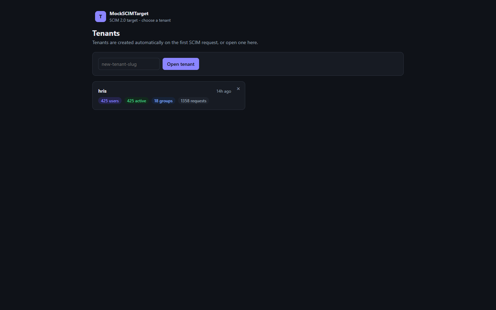
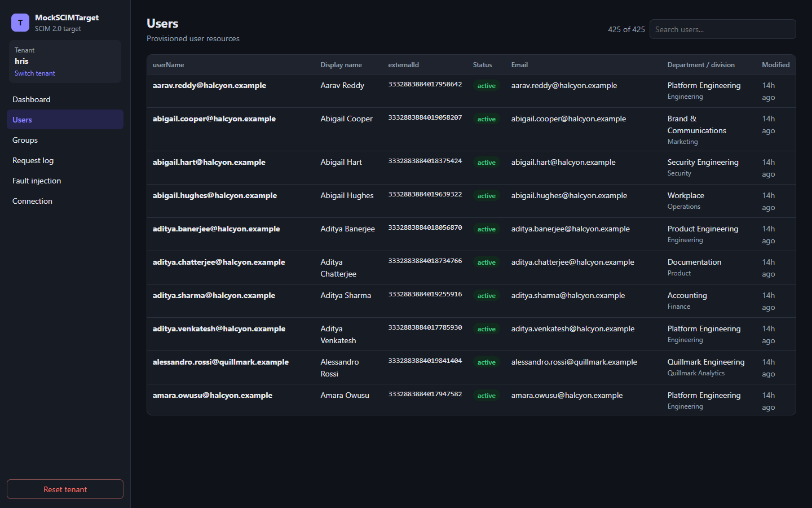
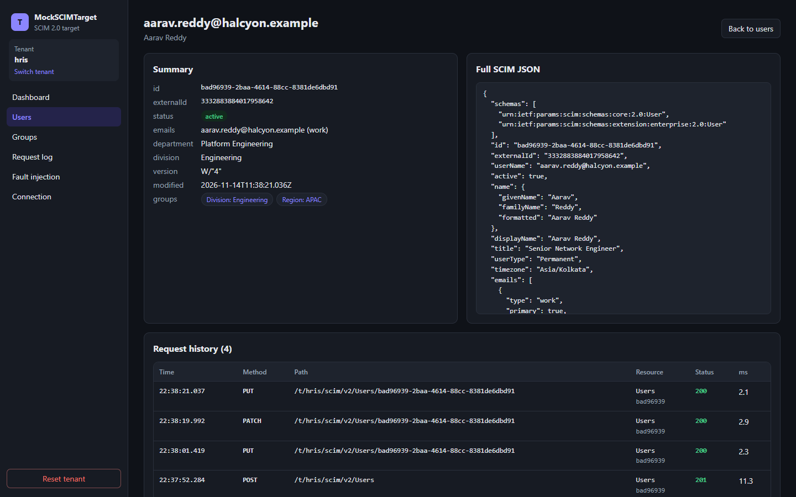
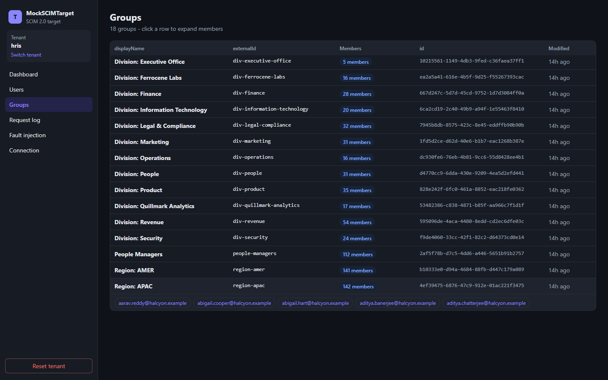
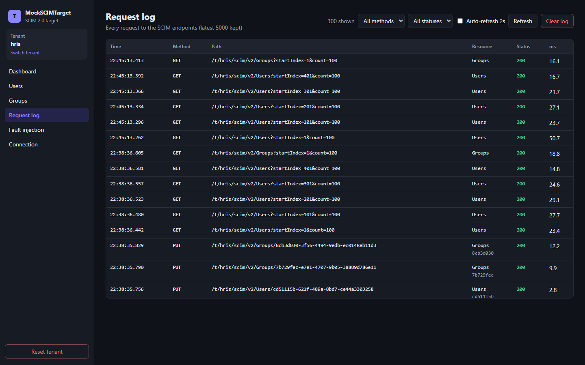
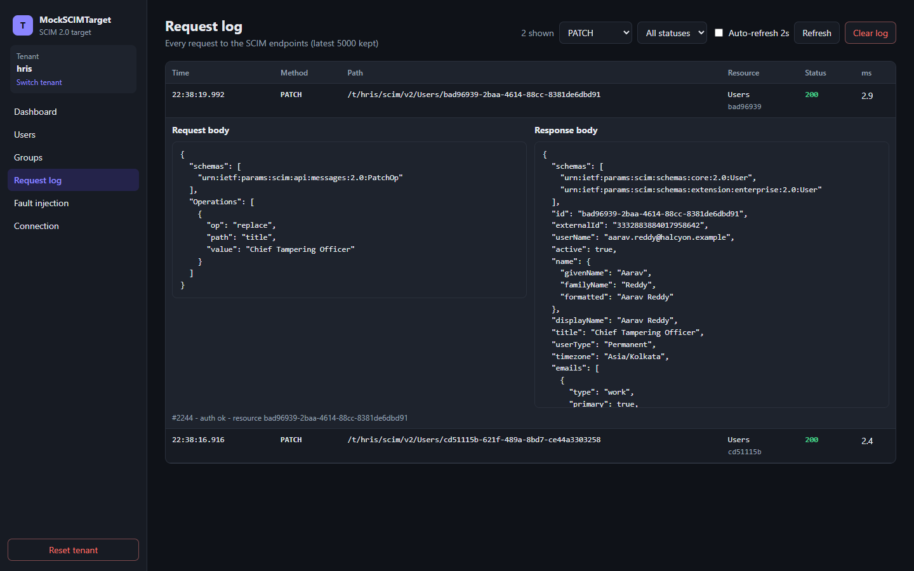
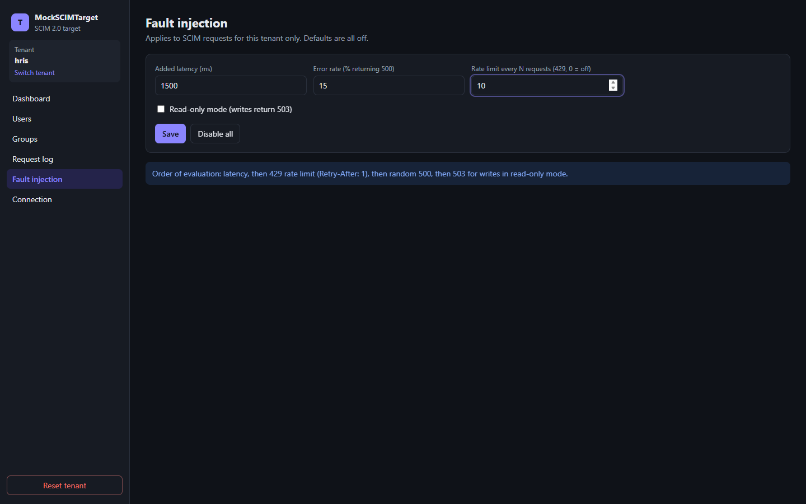
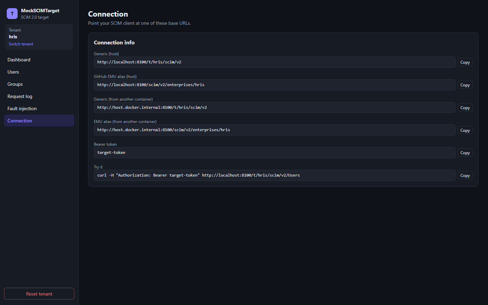

# scim-target


[](https://github.com/dddaaammmooo/scim-mock-target/actions/workflows/security.yml)
[](https://github.com/dddaaammmooo/scim-mock-target/actions/workflows/secret-scan.yml)
[](https://github.com/dddaaammmooo/scim-mock-target/releases)
-brightgreen)

**MockSCIMTarget** is a standalone **SCIM 2.0 service provider** (server) you can point any SCIM
client at. Use it to prove that user and group provisioning behaves as expected, from first
create through to deprovisioning.

It stores everything it receives and records every request. You can inspect both in a web UI or
query them through a JSON admin API. You can also inject latency, errors, rate limiting or a
read-only mode, to test how a client copes with an unreliable target.

It was built as the companion target for
**[scim-mock-hris](https://github.com/dddaaammmooo/scim-mock-hris)**, a mock HR system with a
PingOne-style provisioning engine. It works just as well with Okta, Entra ID, PingOne, a custom
connector, or `curl`.



## User guide

New here? Read the **[User guide](docs/user-guide.md)**. It covers connecting a SCIM client
(MockHRIS, Okta/Entra-style, curl), browsing tenants, debugging a client from the request log,
testing resilience with fault injection, resetting tenants, asserting on the summary API in
automated tests, and troubleshooting.

## Features

- **SCIM 2.0 (RFC 7643 / 7644)**
  - Endpoints: `Users`, `Groups`, `ServiceProviderConfig`, `ResourceTypes` and `Schemas`.
  - Full CRUD, including PUT replace and PATCH with value-filter paths.
  - Filtering with `eq ne co sw ew gt ge lt le pr`, `and`/`or`/`not` and parentheses.
  - Pagination, plus `attributes` / `excludedAttributes`.
- **Enterprise User extension.** It also stores any custom attribute exactly as sent: `roles`,
  `title`, `addresses` and so on.
- **Realistic validation.** It returns SCIM error responses for the cases clients must handle:
  - 409 `uniqueness` on `userName`, `externalId` or a group's `displayName`
  - 400 when a group member doesn't exist
  - 400 `invalidFilter` / `invalidPath`
  - 401 and 404
- **Multi-tenant.** Each tenant has its own users, groups, request log and fault settings.
  Tenants are created on first use, and each one is reachable at two base URLs: a generic
  `/t/{tenant}/scim/v2` and a **GitHub EMU-shaped** `/scim/v2/enterprises/{tenant}`.
- **Request log.** Every SCIM call is recorded with method, path, status, duration, and request
  and response bodies, and can be browsed and filtered in the UI.
- **Fault injection,** per tenant: added latency, a random 500 rate, a 429 with `Retry-After` on
  every Nth request, and a read-only 503 mode.
- **Admin API and UI** for counts, a compact `summary` snapshot built for automated assertions,
  tenant reset and deletion.
- **Few moving parts.** FastAPI, SQLite and a vanilla-JS UI, with no CDN dependencies. It runs
  as a single container with a persistent volume.

## Quick start

```bash
git clone https://github.com/dddaaammmooo/scim-mock-target.git
cd scim-mock-target
docker compose up -d --build
```

| What | Where |
|---|---|
| Web UI | http://localhost:8100 |
| SCIM base URL (generic) | `http://localhost:8100/t/<tenant>/scim/v2` |
| SCIM base URL (GitHub EMU-shaped) | `http://localhost:8100/scim/v2/enterprises/<tenant>` |
| Bearer token | `target-token` (change it with `SCIM_TOKEN=...`) |
| Admin API | `http://localhost:8100/api/...` |

The port is published on `127.0.0.1` only. Data persists in the `scim-data` volume.

### Provision your first user

```bash
curl -s -X POST http://localhost:8100/t/demo/scim/v2/Users \
  -H "Authorization: Bearer target-token" -H "Content-Type: application/scim+json" \
  -d '{
        "schemas": ["urn:ietf:params:scim:schemas:core:2.0:User"],
        "userName": "ada.lovelace@example.com",
        "externalId": "E1001",
        "active": true,
        "name": {"givenName": "Ada", "familyName": "Lovelace"},
        "emails": [{"value": "ada.lovelace@example.com", "type": "work", "primary": true}]
      }'

# what the target now holds (compact snapshot built for test assertions)
curl -s http://localhost:8100/api/tenants/demo/summary
```

Open http://localhost:8100 to see the `demo` tenant, the user, and the logged `POST`. To delete
the tenant, click **×** on its card.

## Screenshots

| Tenants | Dashboard |
|---|---|
|  |  |
| **Users** | **User detail** |
|  |  |
| **Groups** | **Request log** |
|  |  |
| **Request log, entry expanded** | **Fault injection** |
|  |  |
| **Connection** | |
|  | |

Regenerate them from a running instance with `python scripts/screenshots.py`.

## Documentation

| Document | Contents |
|---|---|
| **[User guide](docs/user-guide.md)** | Task-oriented walkthrough with screenshots: connect a client, inspect data, debug from the request log, fault injection, reset/delete, automated tests, troubleshooting |
| [SCIM API reference](docs/scim-api.md) | Endpoints, URL shapes, auth, filtering, pagination, PATCH semantics, enterprise extension, error codes, curl examples |
| [Admin API reference](docs/admin-api.md) | Tenants, resources, request log, summary snapshot, faults, reset |
| [Fault injection](docs/fault-injection.md) | Testing retries, rate limiting and outages |
| [End-to-end testing with scim-mock-hris](docs/end-to-end-with-mockhris.md) | Wiring the two apps together, then provision, verify, leaver and drift scenarios |
| [Architecture & development](docs/architecture.md) | Code layout, storage, middleware, tests, running locally |
| [Deploy to AWS](docs/deploy-aws.md) | Terraform module for ECS Fargate + ALB + EFS: architecture, steps, costs, security (unauthenticated admin API), teardown |

## Configuration

| Variable | Default | Purpose |
|---|---|---|
| `SCIM_TOKEN` | `target-token` | Bearer token required on every SCIM request |
| `DATA_DIR` | `./data` (`/data` in the container) | Where the SQLite database lives |

## Releases and container images

Releases are automated with [release-please](https://github.com/googleapis/release-please).
Commits to `main` follow [Conventional Commits](https://www.conventionalcommits.org/):
- `feat:` produces a minor release
- `fix:` produces a patch release
- `feat!:` or a `BREAKING CHANGE:` footer produces a major release

release-please keeps a release pull request open with the next version and the
`CHANGELOG.md` entry. Merging it tags the release, creates the GitHub release, and publishes
a multi-architecture image (`linux/amd64`, `linux/arm64`) to GitHub Packages. Each image
carries an SBOM and signed build provenance.

```bash
docker pull ghcr.io/dddaaammmooo/scim-mock-target:latest      # or :1, :1.2, :1.2.3
docker run --rm -p 8100:8100 -e SCIM_TOKEN=target-token -v scim-data:/data \
  ghcr.io/dddaaammmooo/scim-mock-target:latest
```

To check an image's provenance: `gh attestation verify oci://ghcr.io/dddaaammmooo/scim-mock-target:latest --owner dddaaammmooo`

## Security

See [SECURITY.md](SECURITY.md) for how to report a vulnerability. Every push and pull request
runs these checks:
- CodeQL for Python, JavaScript and GitHub Actions
- Bandit
- pip-audit
- Trivy, covering the container image and the Dockerfile/Terraform configuration
- Gitleaks secret scanning across the full history
- dependency review on pull requests

GitHub secret scanning with push protection, Dependabot alerts and security updates, and
Dependabot version updates are enabled on the repository. Version updates cover pip,
Actions, Docker and Terraform.

## Security note

This is a **test tool**:
- The admin API and UI have no authentication.
- One shared bearer token protects all SCIM endpoints.
- Request bodies, which may contain personal data, are stored in the request log.

Run it locally or in an isolated test environment only. The default compose file publishes the
port on `127.0.0.1`.

## Development

```bash
python -m venv .venv
.venv/Scripts/pip install -r requirements-dev.txt      # bin/ on macOS/Linux
.venv/Scripts/python -m pytest                         # backend tests, 100% line + branch coverage enforced
.venv/Scripts/python -m playwright install chromium    # once, for the browser tests
.venv/Scripts/python -m pytest -m ui --no-cov          # UI tests (PLAYWRIGHT_CHANNEL=msedge uses installed Edge)
DATA_DIR=./data .venv/Scripts/python -m uvicorn app.main:app --port 8100 --reload
```

CI runs the backend suite with coverage, the Playwright UI suite, and a Docker build with a
health check on every push and pull request.

See [docs/architecture.md](docs/architecture.md) for how the code is organised.
