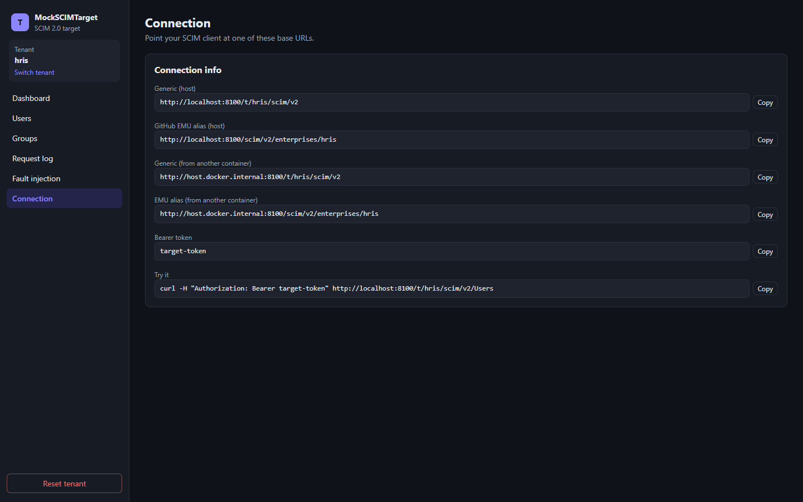
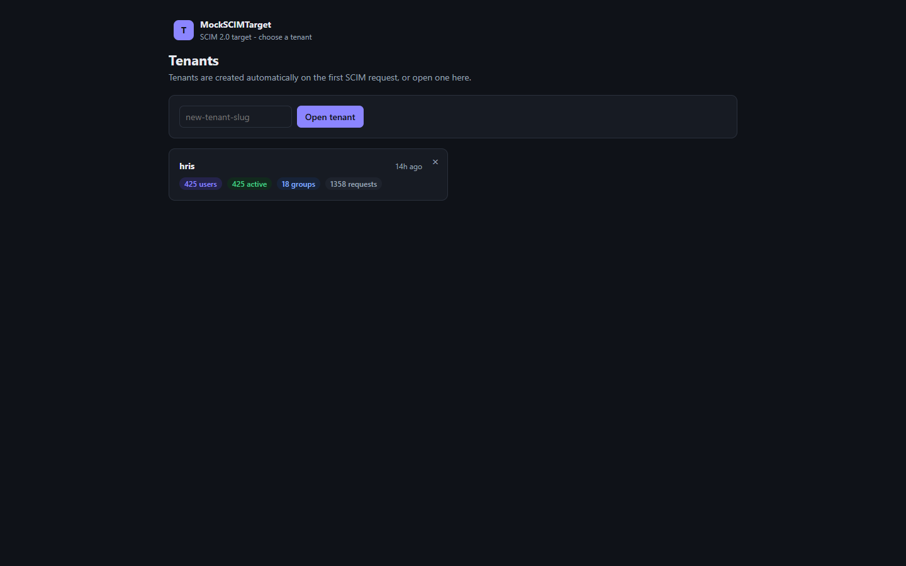
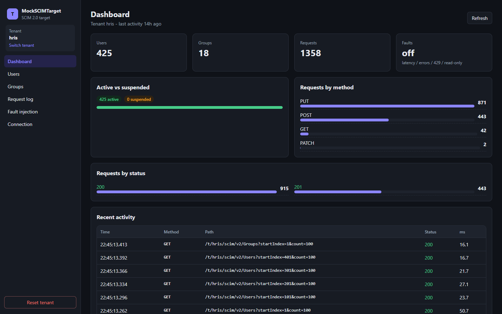
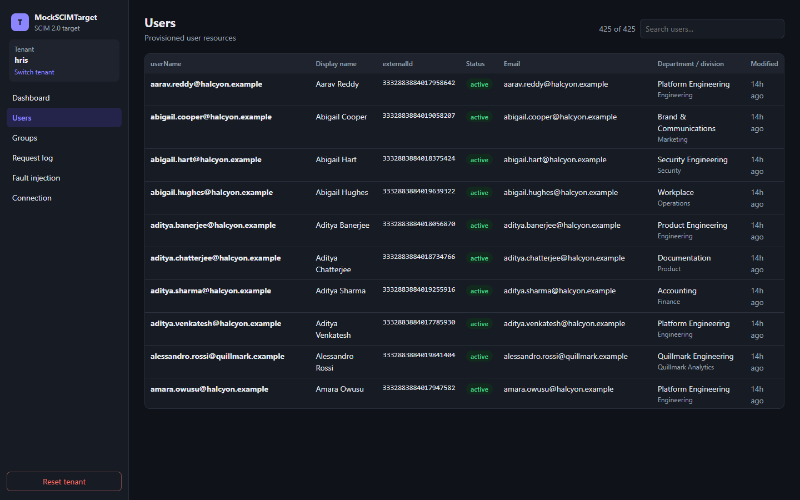
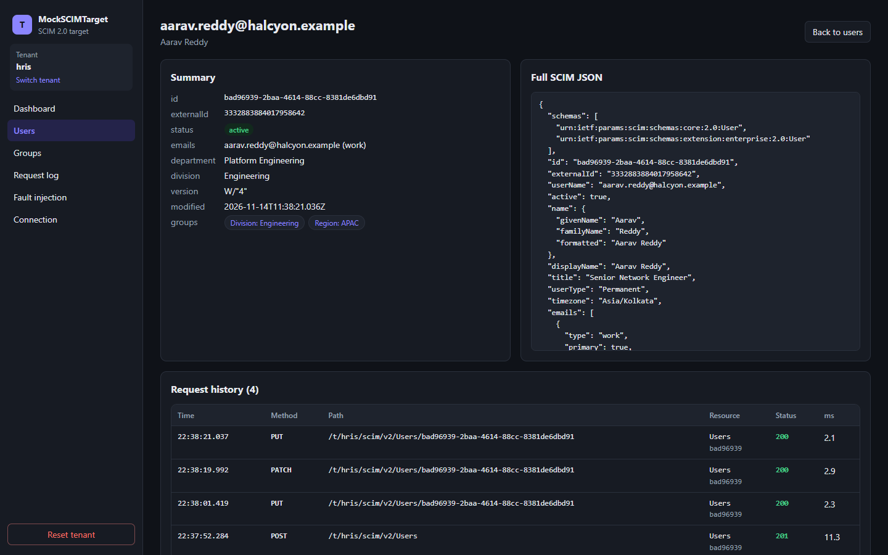
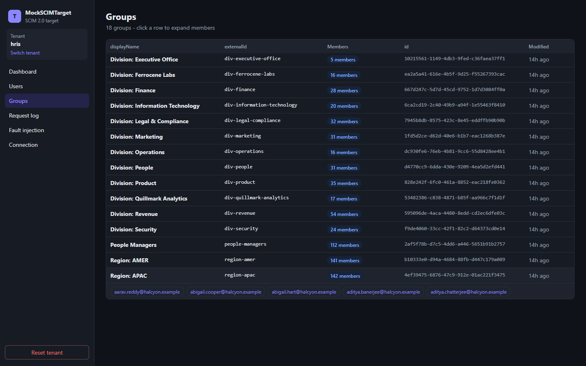
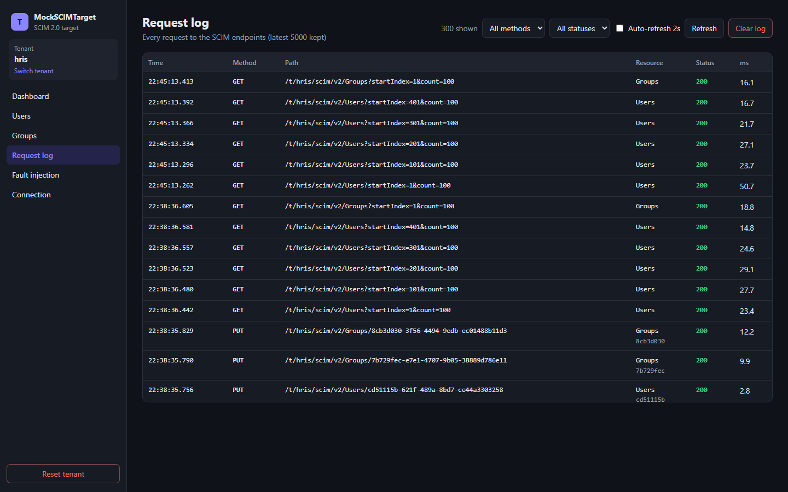
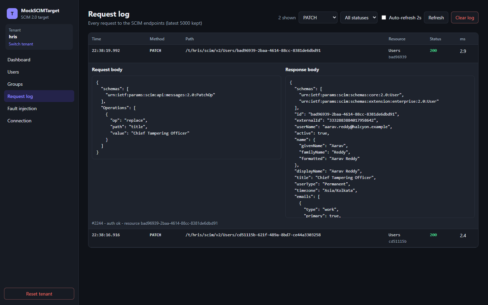
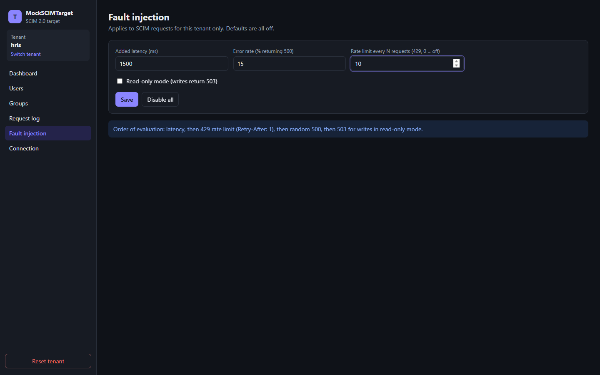

# User guide

This guide walks through the common jobs you will do with scim-target: pointing a SCIM client at
it, checking what it received, debugging a client from the request log, and testing how a client
copes with a misbehaving target. It is task-oriented. For endpoint-by-endpoint detail see the
[SCIM API reference](scim-api.md) and the [Admin API reference](admin-api.md).

Contents:
1. [Getting started](#1-getting-started)
2. [Connecting a SCIM client](#2-connecting-a-scim-client)
3. [Browsing tenants](#3-browsing-tenants)
4. [Inspecting users and groups](#4-inspecting-users-and-groups)
5. [Reading the request log to debug a client](#5-reading-the-request-log-to-debug-a-client)
6. [Testing resilience with fault injection](#6-testing-resilience-with-fault-injection)
7. [Resetting and deleting tenants](#7-resetting-and-deleting-tenants)
8. [Using the summary API in automated tests](#8-using-the-summary-api-in-automated-tests)
9. [Troubleshooting](#9-troubleshooting)

The screenshots show the `hris` tenant after MockHRIS provisioned about 425 users into it. Yours
will be smaller until a client has sent something.

## 1. Getting started

```bash
git clone https://github.com/dddaaammmooo/scim-mock-target.git
cd scim-mock-target
docker compose up -d --build
```

Open <http://localhost:8100>. The first screen lists tenants; on a fresh install it is empty.
Check the server is healthy:

```bash
curl http://localhost:8100/api/health        # {"status":"ok"}
```

Defaults you may want to change:

| Setting | Default | How to change |
|---|---|---|
| Bearer token | `target-token` | `SCIM_TOKEN=... docker compose up -d` |
| Port | `8100`, bound to `127.0.0.1` | edit `ports` in `docker-compose.yml` |
| Data | the `scim-data` volume | `docker compose down -v` deletes it |

## 2. Connecting a SCIM client

Every tenant has two base URLs. Pick whichever your client expects:

| Style | Base URL |
|---|---|
| Generic | `http://localhost:8100/t/<tenant>/scim/v2` |
| GitHub EMU-shaped | `http://localhost:8100/scim/v2/enterprises/<tenant>` |

Both URLs show the same data. The token goes in the `Authorization: Bearer <token>` header.
Tenants are created automatically by the first authenticated request, so choose any name
(letters, digits, `.`, `_`, `-`, up to 64 characters).

The **Connection** page of a tenant lists all URLs with copy buttons, including the
`host.docker.internal` variants for clients running in other containers:



### MockHRIS

[scim-mock-hris](https://github.com/dddaaammmooo/scim-mock-hris) is already set up for this
server. Start both apps, then in MockHRIS open *Integrations → MockSCIMTarget*:

| Field | Value |
|---|---|
| SCIM base URL | `http://host.docker.internal:8100/t/hris/scim/v2` |
| Auth | Bearer `target-token` |

Click **Sync now** in MockHRIS, then open the `hris` tenant here. The full walkthrough, including
joiner, mover, leaver and drift scenarios, is in
[end-to-end-with-mockhris.md](end-to-end-with-mockhris.md).

### Okta, Entra ID, PingOne or any other SCIM client

Use the generic settings of any "SCIM 2.0 / bearer token" connector:

| Setting | Value |
|---|---|
| SCIM connector base URL | `http://<host>:<port>/t/<tenant>/scim/v2` |
| Unique identifier field for users | `userName` |
| Authentication mode | HTTP header / OAuth bearer token |
| Bearer token | the value of `SCIM_TOKEN` |
| Supported actions | push new users, push profile updates, push groups; PATCH is supported |

Cloud services such as Okta or Entra ID cannot reach `localhost`. Expose the port through a
tunnel you control, and remember that the admin API and UI have no authentication, so do not
expose them publicly. A client that supports a "test connection" button usually calls
`GET /ServiceProviderConfig` or `GET /Users?count=1`; both work.

### curl

```bash
curl -s -X POST http://localhost:8100/t/demo/scim/v2/Users \
  -H "Authorization: Bearer target-token" -H "Content-Type: application/scim+json" \
  -d '{"schemas":["urn:ietf:params:scim:schemas:core:2.0:User"],"userName":"ada@example.com","active":true}'
```

## 3. Browsing tenants

The home page lists every tenant as a card with its user, group and request counts and the time
of its last activity. Click a card to open it.



- Type a new slug in the box and press **Open tenant** to look at a tenant before any client has
  used it. It is created on the first SCIM request.
- The **×** in the corner of a card deletes that tenant after a confirmation. See
  [section 7](#7-resetting-and-deleting-tenants).

Each tenant has a **Dashboard** with counts, the split between active and suspended users,
requests by method and by status code, and the latest activity. It refreshes itself every few
seconds.



A *Faults: ON* tile means fault injection is active for the tenant, which explains unexpected
429, 500 or 503 responses in a client.

## 4. Inspecting users and groups

### Users

The **Users** page lists every user. Type in the search box to filter by user name, display
name, external id, email, name or enterprise attributes. The count beside the box shows how many
match.



Click a user to see the summary, the exact SCIM resource the server holds, and the **request
history** for that user: every request that created, read, changed or deleted that resource.



The JSON is what a client would receive from `GET /Users/{id}`, so it is the quickest way to
confirm an attribute mapping: a missing `emails` entry or a wrong `active` flag shows up
immediately. Click a request in the history to see its bodies.

### Groups

The **Groups** page lists groups with their member counts. Click a row to expand it; each member
is a link to that user.



Group membership is stored on the group. A user's `groups` attribute is computed from it, so you
cannot change a user's groups by sending `groups` on the user. Deleting a user also removes them
from every group.

## 5. Reading the request log to debug a client

The **Request log** shows every request made to the tenant's SCIM endpoints, newest first, with
status and duration. Failed authentication attempts are recorded too, but they do not create a
tenant.



Click a row to expand it. You see the request body the client actually sent, the response body
the server returned, and the error message for failures.



A debugging routine that works for most client problems:

1. **Filter by status.** Choose `4xx` to see only what the server rejected. `401` means a token
   problem, `409` a uniqueness conflict, `404` a resource the client believes exists but the
   server does not know.
2. **Expand the failing row** and compare the request body with what you expected the client to
   send. The expanded view shows the error message and SCIM `scimType`.
3. **Check the sequence.** Filter by method to see, for example, whether a `PATCH` was sent
   before the `POST` that creates the user.
4. **Turn on Auto-refresh** while triggering a sync in the client to watch requests arrive live.
   Expanded rows stay open as the list refreshes.
5. **Clear log** before a test run so only that run's requests are visible.

Request bodies are truncated in the log at 16 KB, responses at 4 KB. The latest 5000 requests are
kept across all tenants.

## 6. Testing resilience with fault injection

Real targets are slow, rate-limited and sometimes down. Fault injection reproduces that for one
tenant at a time, so you can check that a client retries, backs off and reports failures
honestly. Open **Fault injection** for the tenant:



| Setting | Effect |
|---|---|
| Added latency (ms) | Every SCIM request is delayed |
| Error rate (%) | That share of requests returns `500` |
| Rate limit every N requests | Every Nth request returns `429` with `Retry-After: 1` |
| Read-only mode | `POST`, `PUT`, `PATCH` and `DELETE` return `503`; reads still work |

### Step by step: does my client honour 429 Retry-After?

1. Open the tenant's **Fault injection** page. Use a scratch tenant, not one with data you care
   about.
2. Enter `3` in *Rate limit every N requests* and press **Save**. A "Fault settings saved" toast
   confirms it. Saving also restarts the request counter.
3. Run your client's sync against that tenant.
4. Open **Request log**, filter by `429`, and expand a row. The response is a SCIM error with
   `Retry-After: 1`.
5. Check the client's behaviour: did it wait and retry, did the retried request succeed, and did
   it give up cleanly if retries ran out?
6. Press **Disable all** (or set the value back to `0`) when you are done.

Other useful scenarios:

| To test | Set |
|---|---|
| Timeouts and progress reporting | latency `1500` or higher, above your client's timeout |
| Retry of transient failures | error rate `15` |
| A planned outage window | read-only mode on, run a sync, turn it off, run again |
| Combined failures | rate limit and error rate together: 429 is evaluated before 500 |

The order of evaluation is latency, then 429, then random 500, then 503 for writes. Faults only
affect SCIM requests; the UI and admin API are never affected. See
[fault-injection.md](fault-injection.md) for the API form and more recipes.

## 7. Resetting and deleting tenants

| Action | Where | Result |
|---|---|---|
| Delete a tenant | **×** on its card on the home page | Removes its users, groups, request log and fault settings, then removes the tenant from the list |
| Reset a tenant | **Reset tenant** at the bottom of the sidebar | Same data removal; you stay on the tenant page, which now shows zero counts |
| Clear only the log | **Clear log** on the Request log page | Keeps users and groups |

Both destructive actions ask for confirmation first. A tenant that receives another SCIM request
is created again, empty. Through the API, `DELETE /api/tenants/{tenant}` does the same, which is
handy between automated test runs.

## 8. Using the summary API in automated tests

`GET /api/tenants/{tenant}/summary` returns a small, stable snapshot meant for assertions: counts,
requests by method and status, fault settings, every user and every group with its members listed
as user names. It needs no token.

```python
import httpx

BASE = "http://localhost:8100"

def test_sync_provisions_everyone():
    httpx.delete(f"{BASE}/api/tenants/ci-run")           # start clean
    run_my_client_sync(base_url=f"{BASE}/t/ci-run/scim/v2", token="target-token")

    s = httpx.get(f"{BASE}/api/tenants/ci-run/summary").json()
    assert s["counts"]["users"] == 25 and s["counts"]["usersInactive"] == 0
    assert s["requestsByStatus"].get("409") is None                # no uniqueness conflicts
    eng = next(g for g in s["groups"] if g["displayName"] == "Engineering")
    assert {"ada@example.com"} <= set(eng["members"])
```

Tips:
- Use a unique tenant per test run (or delete it first) so tests do not see each other's data.
- Assert on `requestsByStatus` to catch silent failures such as a client swallowing 4xx errors.
- Combine with fault injection: `PUT /api/tenants/{t}/faults` before the run, then assert the
  final state is still correct after retries.
- `GET /api/tenants/{t}/requests?method=POST&status=4xx` returns the logged failures when an
  assertion needs an explanation.

## 9. Troubleshooting

| Symptom | Likely cause and fix |
|---|---|
| **401 Unauthorized** on every call | The token is missing or wrong. Send `Authorization: Bearer <SCIM_TOKEN>` (default `target-token`). Find the rejected request in the log: its detail says "Missing or invalid bearer token" and the log marks `auth FAILED`. Rejected calls do not create the tenant. |
| **400 Invalid tenant slug** | Tenant names allow only letters, digits, `.`, `_` and `-`, up to 64 characters. |
| **409 uniqueness** when creating a user or group | `userName` is unique per tenant and compared case-insensitively. `externalId` and a group's `displayName` must be unique too. Look the existing resource up with `GET /Users?filter=userName eq "..."`, then PATCH or PUT it instead of re-creating it. |
| **400 invalidValue: Member(s) not found** when creating or patching a group | Group members must be existing user ids (the `id` returned by the server, not `userName` or `externalId`). Create the users first, and map your own ids to the server ids. |
| **400 invalidFilter** | The filter did not parse: strings need double quotes and URL-encoding (`filter=userName%20eq%20%22ada%22`), and `not` needs parentheses. |
| **400 invalidPath / noTarget / mutability** on PATCH | See [PATCH](scim-api.md#patch): `id`, `meta` and `groups` are read-only, and a filter path with no matching element needs an `eq` filter so the server can create it. |
| **404** on a user the client just created | The client is using a different tenant or base URL, or the tenant was reset or deleted. Compare the `/t/<tenant>/` part of the paths in the request log. |
| 429, 500 or 503 you did not expect | Fault injection is on for this tenant. The dashboard's *Faults* tile shows `ON`; press **Disable all** on the Fault injection page. |
| A client in a container cannot connect to `localhost:8100` | Inside a container `localhost` is the container itself. Use `http://host.docker.internal:8100/...`. On Linux, add `extra_hosts: ["host.docker.internal:host-gateway"]` to that container's compose service. |
| Connection refused from another machine | The port is published on `127.0.0.1` only. Change the mapping in `docker-compose.yml` deliberately, and read the [security note](../README.md#security-note) first. |
| UI shows "Error: ..." in place of a page | The admin API was not reachable. Check `curl http://localhost:8100/api/health` and `docker compose logs scim-target`. |
| Data vanished after restart | Data lives in the `scim-data` volume. `docker compose down -v` removes it; plain `down` or `up --build` keeps it. |
